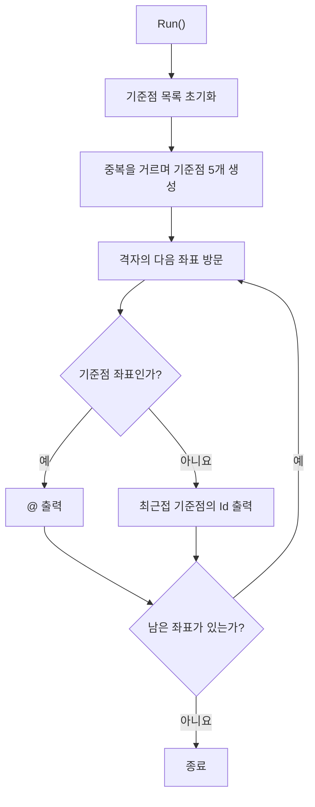

# 보로노이 다이어그램

이 문서는 현재 `VoronoiDiagram.cs`의 구현을 바탕으로 보로노이 다이어그램의 정의와 최근접점 계산 원리를 설명한다. 구현은 15×15 정수 격자에 중복 없는 기준점 5개를 생성하고, 각 좌표를 가장 가까운 기준점의 문자로 표시한다.

## 1. 보로노이 다이어그램이란?

평면 위에 여러 기준점(site)이 있을 때, 각 위치를 가장 가까운 기준점에 따라 나누는 공간 분할이다. 기준점 하나가 담당하는 영역을 보로노이 영역(Voronoi cell)이라고 한다.

예를 들어 기준점이 `a`, `b`, `c`라면, 어떤 위치에서 `b`까지의 거리가 가장 짧을 때 그 위치는 `b`의 영역에 속한다. 기준점의 생성 순서나 문자 자체는 거리 계산에 영향을 주지 않는다. 다만 최소 거리가 같을 때에는 구현에서 정한 선택 규칙이 적용된다.

기준점 집합을 $S=\{s_1,s_2,\ldots,s_n\}$, 평면 위의 위치를 $p$라 하면 기준점 $s_i$의 영역은 다음과 같이 정의할 수 있다.

$$
V_i = \left\{p \in \mathbb{R}^2 \mid d(p,s_i) \le d(p,s_j),\ \forall j \in \{1,\ldots,n\}\right\}
$$

*수식 1. 보로노이 영역의 정의 (Latex)*

여기서 $d$는 두 점 사이의 거리이다. 이 코드에서는 직선 거리인 유클리드 거리를 사용한다.

정의에 $\le$가 들어가므로, 최소 거리가 같은 위치는 여러 영역에 동시에 포함될 수 있다. 이러한 위치가 영역 사이의 경계를 이룬다.

## 2. 연속 평면을 정수 격자에 표시하기

수학적 정의는 평면의 모든 실수 좌표를 대상으로 한다. 현재 구현은 그중 정수 좌표만 방문한다.

$$
\begin{aligned}
x,y &\in \{0,1,\ldots,14\} \\
15 \times 15 &= 225
\end{aligned}
$$

*수식 2. 정수 격자의 좌표 범위와 검사 위치 수 (Latex)*

따라서 화면은 보로노이 영역을 정수 격자에서 표본화한 결과이다. 영역 경계의 선분이나 꼭짓점 좌표를 별도로 구하기보다는, 방문한 각 좌표의 최근접 기준점을 직접 찾는다.

화면의 한 문자 칸은 하나의 좌표를 나타낸다. 칸 전체 면적에서 동일한 기준점이 가장 가깝다는 뜻은 아니다.

| 표시 | 의미 |
|---|---|
| `@` | 기준점이 실제로 놓인 좌표 |
| `a`~`e` | 해당 좌표에서 가장 가까운 기준점의 Id |

기준점에서는 그 점 자신까지의 거리가 0이다. 현재 구현은 계산 전에 `HasPoint()`로 해당 위치를 확인하고 `@`를 출력한다.

콘솔에서는 위쪽부터 $y=0,1,2,\ldots$ 순서로 출력하므로, 화면 아래쪽으로 갈수록 $y$가 커진다. 이는 좌표를 화면에 배치하는 방식이며 거리 계산에는 영향을 주지 않는다.

## 3. 거리 계산과 제곱근 생략

### 3.1 유클리드 거리

검사 위치가 $p=(x,y)$, 기준점이 $s=(X,Y)$일 때 거리는 피타고라스 정리로 구한다.

$$
\begin{aligned}
\Delta x &= x-X \\
\Delta y &= y-Y \\
d(p,s) &= \sqrt{(\Delta x)^2+(\Delta y)^2}
\end{aligned}
$$

*수식 3. 좌표 차이와 유클리드 거리 (Latex)*

`deltaX`와 `deltaY`는 각각 $\Delta x$, $\Delta y$에 대응한다. 코드의 다음 식은 실제 거리의 제곱을 계산한다.

$$
\mathtt{distance} = (\Delta x)^2+(\Delta y)^2 = d(p,s)^2
$$

*수식 4. 코드에서 계산하는 제곱 거리 (Latex)*

현재 변수 이름은 `distance`이지만, 저장되는 값은 제곱 거리이다.

### 3.2 가까운 순서를 비교할 때 루트가 필요 없는 이유

거리는 음수가 아니며, 제곱근 함수는 음수가 아닌 범위에서 엄격하게 증가한다. 따라서 제곱 거리의 순서와 실제 거리의 순서는 같다.

$$
\begin{aligned}
9 &< 25 \\
\sqrt{9} &< \sqrt{25} \\
3 &< 5
\end{aligned}
$$

*수식 5. 제곱근 계산 전후에 유지되는 거리 순서 (Latex)*

최소값을 만드는 기준점도 동일하다. 아래의 $\operatorname{arg\,min}$은 식의 값이 최소가 되는 기준점의 인덱스를 나타내며, 동률이면 여러 인덱스가 해당할 수 있다.

$$
\operatorname*{arg\,min}_{1 \le i \le n} d(p,s_i)
=
\operatorname*{arg\,min}_{1 \le i \le n} d(p,s_i)^2
$$

*수식 6. 거리와 제곱 거리에 대한 최근접 기준점의 일치 (Latex)*

이 때문에 최근접점 판정에는 제곱근을 계산할 필요가 없다. Unity의 `sqrMagnitude`를 이용한 거리 비교도 같은 원리이다.

실제 거리 값을 표시하거나 거리 자체를 다른 계산에 사용하려면 제곱근이 필요하다.

## 4. 같은 거리와 영역 경계

### 4.1 수학적 정의의 ≤와 코드의 <

영역 정의의 $\le$는 “이 기준점까지의 거리가 다른 모든 기준점까지의 거리보다 작거나 같다”는 뜻이다. 반면 코드의 `distance < minDistance`는 순회 중 기억해 둔 최소값을 갱신하는 조건이다.

두 조건은 쓰이는 목적이 다르다. 현재 코드는 각 칸에 표시할 문자 하나를 선택한다.

| 최소값 갱신 조건 | 최소 거리가 같은 기준점이 여러 개일 때 |
|---|---|
| `distance < minDistance` | 먼저 순회한 기준점 유지 |
| `distance <= minDistance` | 나중에 순회한 기준점으로 교체 |

현재는 `<`를 사용하므로 먼저 목록에 추가된 기준점이 선택된다. 이 규칙은 기준점 중복 제거와 별개이며, 경계에 있는 칸에 문자를 하나 배정하기 위한 규칙이다.

`<=`로 바꾸어도 여러 영역을 동시에 표시하지는 않는다. 경계를 별도 문자로 표시하려면 최소 거리가 같은 기준점이 여러 개인지를 따로 기록해야 한다.

### 4.2 경계가 있어도 동률인 격자 칸이 없을 수 있다

두 기준점이 $A=(x_a,y_a)$, $B=(x_b,y_b)$일 때 같은 거리가 되는 위치는 다음 조건을 만족한다.

$$
(x-x_a)^2+(y-y_a)^2=(x-x_b)^2+(y-y_b)^2
$$

*수식 7. 두 기준점까지의 거리가 같은 조건 (Latex)*

식을 전개하고 정리하면 다음과 같다.

$$
2(x_b-x_a)x+2(y_b-y_a)y=x_b^2+y_b^2-x_a^2-y_a^2
$$

*수식 8. 수직이등분선의 방정식 (Latex)*

이는 두 기준점을 잇는 선분의 수직이등분선이다. 두 점만 있을 때는 이 선이 두 영역의 경계가 된다.

| 두 기준점 | 같은 거리가 되는 선 | 정수 격자에서의 동률 |
|---|---|---|
| $(0,0)$, $(1,0)$ | $x=0.5$ | 없음 |
| $(0,0)$, $(2,0)$ | $x=1$ | 해당 열에서 발생 |

첫 번째 예에서는 평면에 경계가 존재하지만 정수 좌표를 통과하지 않는다. 격자 범위를 넓혀도 검사 간격이 1이라면 이 경계 위의 점은 검출되지 않는다. 즉, 15×15라는 크기 자체보다 기준점 배치와 검사 좌표의 간격이 중요하다.

또한 여러 기준점이 있을 때, 두 점까지의 거리가 같다는 조건만으로 보로노이 경계가 되지는 않는다. 다른 기준점이 더 가까우면 해당 위치는 그 다른 점의 영역이다. **최소 거리인 기준점이 여러 개**여야 영역 경계에 해당한다.

### 4.3 손으로 계산하는 예

기준점이 $a=(0,0)$, $b=(4,0)$인 경우, $y=0$인 다섯 좌표를 검사해 보자. 아래 표는 원리를 위한 별도 예시이며, 난수로 생성된 실제 실행 결과를 나타내지는 않는다.

| 검사 좌표 | a까지 제곱 거리 | b까지 제곱 거리 | 선택되는 Id | 화면 표시 |
|---|---:|---:|---|---|
| $(0,0)$ | 0 | 16 | a | `@` |
| $(1,0)$ | 1 | 9 | a | `a` |
| $(2,0)$ | 4 | 4 | a | `a` |
| $(3,0)$ | 9 | 1 | b | `b` |
| $(4,0)$ | 16 | 0 | b | `@` |

목록에서 a가 먼저 순회된다면 가운데 동률 위치는 a로 표시된다. 두 기준점 위치에는 Id 대신 `@`가 표시된다.

## 5. 클래스 구성과 실행 흐름

현재 클래스는 기준점 데이터와 콘솔 예제의 실행을 함께 관리한다.

| 구성 요소 | 역할 |
|---|---|
| `Point` | 기준점 하나의 좌표와 표시용 Id를 보관하는 비공개 구조체 |
| `_points` | 생성된 기준점을 보관하는 비공개 인스턴스 목록 |
| `Run()` | 설정, 기준점 생성, 좌표 목록 출력, 격자 출력을 순서대로 실행 |
| `HasPoint(x, y)` | 동일 좌표의 기준점이 목록에 있는지 확인 |
| `FindNearestPointId(x, y)` | 제곱 거리가 최소인 기준점의 Id 반환 |

`Point`는 생성자에서 좌표와 Id를 함께 설정한다. 중복 좌표를 먼저 확인하므로, 채택되지 않을 좌표에 대해 기준점을 만들거나 Id를 증가시킬 필요가 없다.

### 5.1 기준점 생성

1. `size = 15`, `dotCount = 5`, 시작 문자 `a`를 설정한다.
2. `new Random()`으로 난수 생성기를 만들고 기준점 목록을 초기화한다.
3. `rand.Next(size)`로 각 좌표를 생성한다. 결과 범위는 0 이상 15 미만이다.
4. `HasPoint()`가 같은 좌표를 찾으면 이번 시도를 건너뛴다.
5. 중복이 없으면 `Point(posX, posY, ch)`를 생성한다.
6. 다음 기준점을 위해 `ch`를 증가시키고 현재 점을 목록에 추가한다.
7. 생성한 좌표를 출력하고, 점이 5개가 될 때까지 반복한다.

중복 좌표가 나온 경우에는 `ch`를 증가시키지 않으므로 채택된 점에만 a~e가 순서대로 배정된다.

### 5.2 격자 출력

기준점 생성이 끝나면 y를 바깥 반복문, x를 안쪽 반복문으로 사용해 행 단위로 출력한다.



현재 구현은 기준점도 한 문자, 일반 칸도 한 문자를 출력한다. 따라서 모든 행은 문자 15개로 구성된다.
출력의 오른쪽 끝과 아래쪽 끝은 검사 범위의 끝이다. 보로노이 영역 자체가 그 위치에서 끝난다는 뜻은 아니다.

### 5.3 최근접점 탐색

`FindNearestPointId()`는 현재까지 확인한 최소 제곱 거리와 해당 Id를 기억한다.

1. `minDistance`를 `float.MaxValue`로, `nearestId`를 공백으로 초기화한다.
2. 목록의 기준점을 생성 순서대로 순회한다.
3. 검사 위치와 기준점의 제곱 거리를 계산한다.
4. 기존 최소값보다 작으면 최소값과 Id를 함께 갱신한다.
5. 모든 점을 확인한 뒤 최종 Id를 반환한다.

각 기준점을 처리한 직후, 기억한 최소값은 “지금까지 확인한 모든 기준점 중 최소 거리”이다. 이 성질을 유지하며 마지막 점까지 확인하므로 전체 목록의 최근접점을 얻는다.

현재는 서로 다른 기준점이 5개 존재하고 모든 거리가 유한하므로 첫 기준점에서 반드시 값이 갱신된다. 따라서 정상 실행에서 초기값인 공백이 결과로 남지 않는다. 동률 위치도 현재 선택 규칙에 따라 문자 하나가 출력된다.

## 6. 연산량과 저장 공간

격자의 한 변 길이를 $S$, 기준점 수를 $N$이라 하자.

- `HasPoint()`는 목록을 순회하므로 최악의 경우 $\mathcal{O}(N)$이다.
- `FindNearestPointId()`도 모든 기준점을 확인하므로 $\mathcal{O}(N)$이다.
- 출력 위치는 $S^2$개이므로 격자 전체의 계산량은 $\mathcal{O}(S^2N)$이다.
- 전체 격자 결과를 저장하지 않고 바로 출력하므로, 기준점 목록을 위한 저장 공간은 $\mathcal{O}(N)$이다.

기준점이 아닌 좌표에서는 존재 확인과 최근접점 탐색을 각각 실행하지만, 두 작업을 합산한 $\mathcal{O}(N)+\mathcal{O}(N)$도 점근적으로 $\mathcal{O}(N)$이다.

현재는 $S=15$, $N=5$로 작아 직접 모든 기준점을 확인하는 방식이 명확하다. 여기서 연산량 표기는 코드 구조에 대한 분석이며 실행 시간을 측정한 결과는 아니다.

기준점 생성 단계에는 중복으로 인한 재시도가 있다. 전체 생성 시도 횟수를 $M$이라 하면 좌표 중복 검사에는 최악의 경우 $\mathcal{O}(MN)$의 작업이 필요하다. $M$은 중복 발생에 따라 달라진다.

## 7. 설정을 해석할 때 알아둘 조건

현재 설정에서는 225개의 서로 다른 좌표 중 5개를 선택한다.

- 격자 범위를 넘는 수의 기준점을 요구하면 더 이상 새 좌표를 추가할 수 없어 생성 반복문이 끝나지 않는다. 예를 들어 `size = 15`일 때 `dotCount > 225`가 이에 해당한다.
- `dotCount = 0`이면 기준점이 없으므로 최근접점 함수가 초기 공백을 반환한다. 현재의 양수 개수 설정에서는 발생하지 않는다.
- Id는 `ch++`로 증가한다. 현재 5개에서는 a~e를 사용하며, 개수를 늘려도 자동으로 여러 글자 이름을 만드는 구조는 아니다.
- `new Random()`에는 명시적인 고정 시드가 없다. 재현 가능한 실험이 필요하다면 별도의 변경으로 시드를 지정할 수 있다.

이 조건들은 현재 코드가 입력값을 검증하거나 자동으로 보정한다는 의미가 아니다. 현재 구현의 설정과 동작 범위를 설명한다.

## 8. 이 구현으로 확인할 수 있는 원리

이 구현은 정수 격자의 각 좌표를 가장 가까운 기준점에 배정한다. 제곱 거리로 최근접점을 찾고, 최소 거리가 같으면 먼저 생성된 기준점을 선택한다.

## 9. 코드 원문

아래 코드는 문서 작성 시 읽은 파일을 생략 없이 수록한 것이다. 설명을 위해 코드 내부를 수정하거나 주석을 추가하지 않았다.

```csharp
using System;
using System.Collections.Generic;

namespace ConsoleApp1
{
    internal class VoronoiDiagram
    {
        private struct Point
        {
            public char Id { get; private set; }
            public int X { get; private set; }
            public int Y { get; private set; }

            public Point(int x, int y, char id)
            {
                Id = id;
                X = x;
                Y = y;
            }
        }

        private List<Point> _points = null;

        public void Run()
        {
            const string dot = "@";

            int size = 15;
            int dotCount = 5;

            char ch = 'a';
            Random rand = new Random();

            _points = new List<Point>(dotCount);
            while (_points.Count < dotCount)
            {
                int posX = rand.Next(size);
                int posY = rand.Next(size);
                if (HasPoint(posX, posY))
                    continue;

                Point point = new Point(posX, posY, ch);
                ch++;
                _points.Add(point);
                Console.Write($"x:{posX}, y:{posY}");

                if (_points.Count < dotCount)
                    Console.Write(" / ");
                else
                    Console.WriteLine();
            }

            Console.WriteLine("---");

            for (int y = 0; y < size; y++)
            {
                for (int x = 0; x < size; x++)
                {
                    if (HasPoint(x, y))
                    {
                        Console.Write($"{dot}");
                    }
                    else
                    {
                        char id = FindNearestPointId(x, y);
                        Console.Write($"{id}");
                    }
                }

                Console.WriteLine();
            }
        }

        private bool HasPoint(int x, int y)
        {
            foreach (var point in _points)
            {
                if (point.X == x && point.Y == y)
                    return true;
            }

            return false;
        }

        private char FindNearestPointId(int x, int y)
        {
            char nearestId = ' ';
            float minDistance = float.MaxValue;

            foreach (var item in _points)
            {
                float deltaX = x - item.X;
                float deltaY = y - item.Y;
                // 거리의 대소 관계만 비교하므로 제곱근 계산을 생략한다.
                float distance = deltaX * deltaX + deltaY * deltaY;
                if (distance < minDistance)
                {
                    minDistance = distance;
                    nearestId = item.Id;
                }
            }

            return nearestId;
        }
    }
}
```

## 10. 결과

```text
x:1, y:10 / x:7, y:13 / x:12, y:2 / x:6, y:7 / x:9, y:2
---
deeeeeeeeeecccc
ddeeeeeeeeecccc
ddddeeeee@ec@cc
adddddeeeeecccc
addddddeeeecccc
aadddddddeecccc
aaaddddddddcccc
aaaddd@dddddccc
aaaaddddddddccc
aaaadddddddddcc
a@aaaddbbbbbbbb
aaaaabbbbbbbbbb
aaaabbbbbbbbbbb
aaaabbb@bbbbbbb
aaabbbbbbbbbbbb
```
